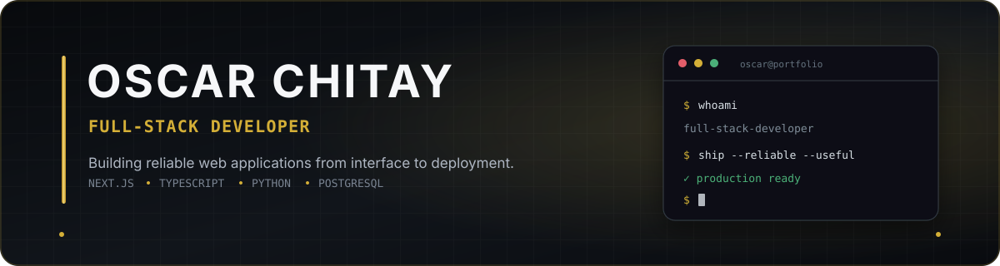

  

  

  
  
  

## About me

I'm a full-stack developer focused on building practical, end-to-end web applications. My recent work includes designing and developing a construction project management platform with budgeting, unit price analysis, scheduling, field logs, cost control, authentication, automated tests, and continuous integration.

I enjoy turning operational requirements into maintainable software, from responsive interfaces and REST APIs to relational data models and production deployments.

## Featured projects

### [Constructora Rochhe](https://github.com/OscarChitay/constructora-rochhe-portfolio)

A full-stack platform for managing construction projects, from budgeting and unit price analysis to schedules, field logs, costs, and reports.

- Role-based authentication and protected application modules
- Construction budgeting and unit price analysis workflows
- Automated frontend and backend tests with GitHub Actions CI
- Sanitized public edition without operational or client data

**[Explore the repository](https://github.com/OscarChitay/constructora-rochhe-portfolio) · [Visit the live application](https://www.constructorarochhe.com/)**

### [Educational Compiler](https://github.com/OscarChitay/p1-copiler)

A collaborative Python desktop application that explores the main stages of a compiler for a simplified programming language.

- Lexical, syntactic, and semantic analysis with PLY
- Abstract syntax tree visualization with Graphviz
- Intermediate-code generation, optimization, and NASM output
- My contributions: decrement and ternary operators, colon handling, and documentation

**[Explore the repository](https://github.com/OscarChitay/p1-copiler)**

## Core stack

### Frontend

  
  
  
  
  
  
  

### Backend and APIs

  
  
  
  
  
  

### Data and development

  
  
  
  

<strong>Additional technologies and tools</strong>

### Languages and data

### Platforms and delivery

### Quality, UI, and specialized tools

Also experienced with SQLModel, SQLAlchemy, Alembic, responsive design, accessibility, UML, technical documentation, and collaborative Git workflows.

## Education

**Universidad Mariano Gálvez de Guatemala**

Systems Engineering coursework completed; final degree examination pending.

## Let's connect

I'm open to full-stack development opportunities in Guatemala and with remote teams.

**[LinkedIn](https://www.linkedin.com/in/oscar-chitay) · [Email](mailto:oscarchitayy@gmail.com)**
